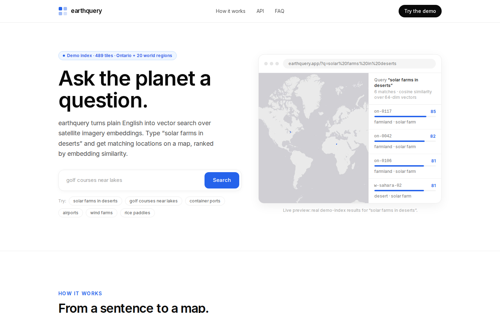
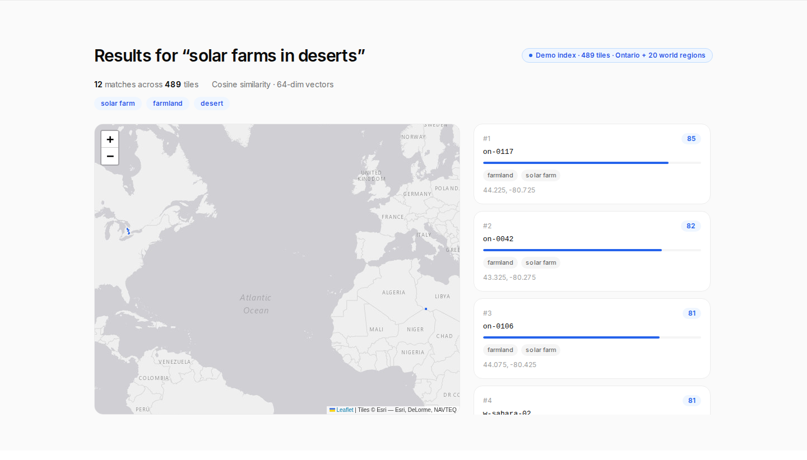
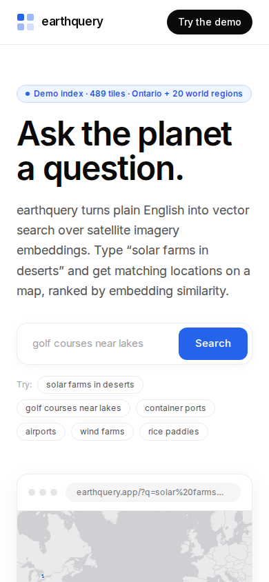
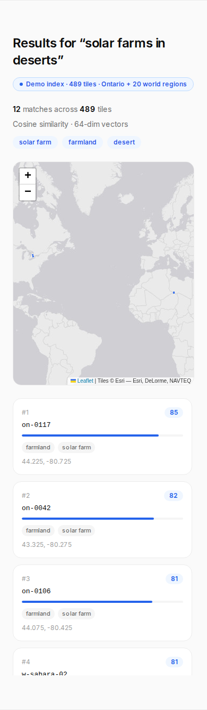

# earthquery: ask the planet a question

**Natural-language search over satellite imagery embeddings.** Type "solar farms in deserts" and get matching locations on a map, ranked by embedding similarity. No GIS syntax, no bounding-box math.

Keywords: natural language satellite imagery search, geospatial vector search, earth observation, remote sensing, AlphaEarth, EmbeddingGemma, satellite embedding search.




## What it is

earthquery proves a simple loop: a natural-language query becomes an embedding vector, cosine search ranks every tile in a planetary index against that vector, and the winners render as map footprints. The same ranking is available as JSON at `GET /api/search`, so AI agents can skip the UI entirely.

The architecture is provider-agnostic (`lib/providers.ts`): text query -> `EmbeddingProvider.embed(text)` -> cosine search over tile vectors -> ranked tiles. v1 ships with a demo provider and a bundled demo index. The production adapters for EmbeddingGemma 2 and AlphaEarth are documented in code, ready for credentials.

## Live demo

The landing page search bar runs live against the demo index. Example queries:

- `solar farms in deserts`
- `golf courses near lakes`
- `container ports`
- `airports`
- `wind farms`
- `rice paddies`

Deep-link any query: `/?q=golf+courses+near+lakes`. The map fits to the result footprints; clicking a result card highlights its tile.

Mobile: the layout collapses to a single column with the map above the result cards.




## Quickstart

Requirements: Node.js 20+.

```bash
npm install
node scripts/generate-tiles.mjs   # regenerates public/data/tiles.json (deterministic)
npm run dev                        # http://localhost:3000
```

Production build and lint:

```bash
npm run build
npm run lint
```

## API

No API key in v1.

| Method | Path | Description |
| ------ | ---- | ----------- |
| GET | `/api/search?q=…&limit=12` | Ranked tile matches. `limit` clamps to 1-50. HTTP 400 when `q` is missing. |
| GET | `/api/health` | Status, provider, dimensions, tile count, coverage. |
| GET | `/llms.txt` | Agent-readable project description and API summary. |

Example:

```bash
curl "http://localhost:3000/api/search?q=solar+farms+in+deserts&limit=3"
```

Response shape:

```json
{
  "query": "solar farms in deserts",
  "provider": "demo-concept-embedder",
  "dimensions": 64,
  "tile_count": 489,
  "matched_concepts": ["solar farm", "desert"],
  "demo": true,
  "results": [
    {
      "tile_id": "w-sahara-11",
      "bbox": [23.52, 12.72, 23.64, 12.84],
      "center": [23.58, 12.78],
      "score": 97,
      "tags": ["desert", "solar farm", "oil field"]
    }
  ]
}
```

`bbox` is `[south, west, north, east]` in decimal degrees. `score` is cosine similarity scaled to 0-100. An empty `results` array with empty `matched_concepts` means the query matched no known concept; the UI suggests concrete land-use terms instead.

## Demo vs production

**v1 is a demo index, and it says so everywhere it matters** (UI badge, API `demo` flag, this section). What is real: the pipeline, the API contract, the provider interface, the map rendering. What is simulated: the vectors.

| Layer | Demo (v1) | Production path |
| ----- | --------- | --------------- |
| Query embedding | Keyword to concept map, 64-dim (`DemoEmbeddingProvider`) | EmbeddingGemma 2, 768-dim, via Hugging Face Inference API (`EmbeddingGemmaProvider` in `lib/providers.ts`, needs `HF_TOKEN`) |
| Tile index | 489 seeded tiles in `public/data/tiles.json` | AlphaEarth Satellite Embedding V1 annual mosaic, Google Earth Engine |
| Coverage | Southern Ontario grid + 20 world-region anchors | Global, 10m resolution, 2017-2025 |
| Vectors | Simulated from concept tags | Measured from multi-sensor satellite imagery |

To go to production:

1. Sign up for Google Earth Engine and authenticate the client.
2. Sample mean 64-dim embeddings per tile from `GOOGLE_SATELLITE_EMBEDDING_V1_ANNUAL` and save the manifest as `data/alphaearth-tiles.json` in the `Tile` shape.
3. Set `HF_TOKEN` and pass the EmbeddingGemma 2 model id to `EmbeddingGemmaProvider`.
4. The cosine search in `lib/search.ts` is dimension-agnostic; no search code changes needed.

Regenerating or extending the demo index:

```bash
node scripts/generate-tiles.mjs          # writes public/data/tiles.json + concepts.json
```

Add anchors to the `ANCHORS` array in the script (name, lat, lng, tag pool) or widen the Ontario grid, then rerun. Output is deterministic from seeds.

## Data sources and licenses

- Code: MIT (see LICENSE).
- AlphaEarth Satellite Embedding V1: CC-BY 4.0 ([Earth Engine catalog](https://developers.google.com/earth-engine/datasets/catalog/GOOGLE_SATELLITE_EMBEDDING_V1_ANNUAL)).
- EmbeddingGemma 2 (Google, Oct 2026): Apache 2.0.
- Map tiles: (c) Esri (World Light Gray basemap). CARTO's light basemap now requires an API key; swap the `TileLayer` URL in `components/MapView.tsx` if you have one.

## Roadmap

- [ ] Earth Engine tile-manifest exporter (production index builder)
- [ ] EmbeddingGemma 2 query path behind `EMBEDDING_PROVIDER=gemma2`
- [ ] Tile count and coverage config via environment
- [ ] Result clustering for dense matches
- [ ] `/api/search` POST with vector input for agent pipelines
- [ ] Hosted demo deployment

## Project structure

```
app/                  # Next.js app router: page, layout, API routes
components/           # UI: Hero, MapView (Leaflet), ResultsSection, HowItWorks, ApiSection, Faq
lib/                  # geo.ts (types), providers.ts (embedding providers), search.ts (cosine search)
public/data/          # tiles.json + concepts.json (generated demo index)
scripts/              # generate-tiles.mjs (deterministic index builder), screenshot.mjs (verification)
llms.txt              # agent-readable project card (also served at /llms.txt)
SKILL.md              # Claude Code skill for the API
```
